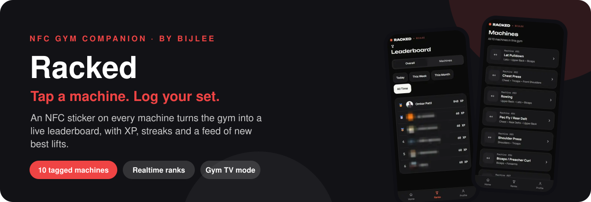
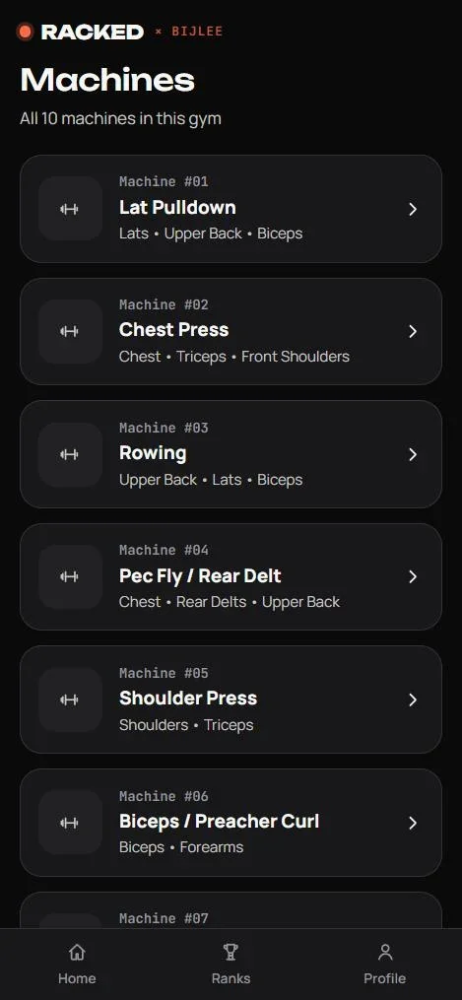
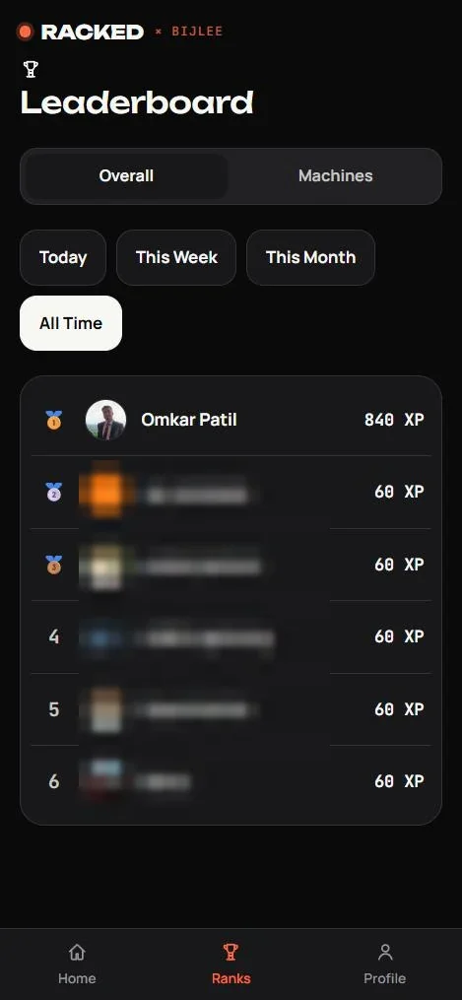
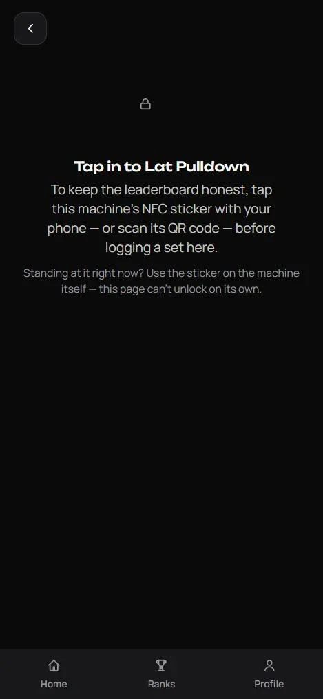
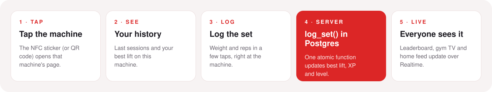
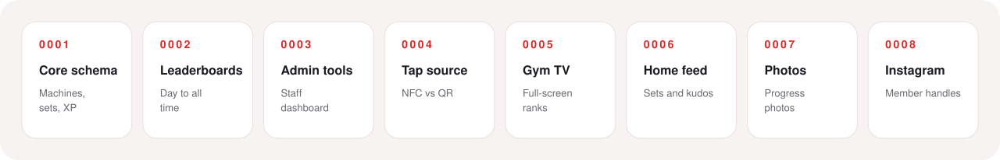

<div align="center">



<br/>

[](https://racked-app-liard.vercel.app)
[](https://bijlee.run)


**[Why](#01--why-it-exists)** ·
**[The product](#02--the-product)** ·
**[How it works](#03--how-it-works)** ·
**[Built in public](#04--built-in-public)** ·
**[Where it stands](#05--where-it-stands)** ·
**[Run it](#07--run-it-yourself)**

</div>

---

## 01 · Why it exists

Gym progress lives in people's heads, or in a notes app nobody opens twice. **Racked** puts a small NFC sticker on each machine. Tap it and you see your history and best lift on that machine, log the set in seconds, and see where you rank against everyone else in the gym.

It's also an experiment for **[EZZ BILL](https://github.com/omkarpatilswork/ez-bill1)**. EZZ BILL's restaurant flow depends on people being willing to tap an NFC tag to get something. Racked tests that habit cheaply, with real people, before EZZ BILL bets on it. It runs at **[Bijlee](https://bijlee.run)**, a Pune community for runners, founders and builders.

## 02 · The product

<table>
<tr>
<td width="33%"><br/><sub><b>Machines.</b> All ten tagged machines, each with its muscle groups.</sub></td>
<td width="33%"><br/><sub><b>Leaderboard.</b> Overall or per machine, for today, the week, the month or all time.</sub></td>
<td width="33%"><br/><sub><b>Tap in.</b> A machine unlocks when you tap its sticker.</sub></td>
</tr>
</table>

| | |
|---|---|
| **Tap to log** | Each machine's NFC tag (or QR code) opens that machine: your history, your best lift and a quick set logger |
| **Live leaderboards** | Overall and per-machine rankings for today, the week, the month or all time, updated the moment anyone logs a set |
| **XP, levels and streaks** | XP per set, a level per machine, attendance streaks and a calendar of the days you trained |
| **Home feed** | A feed of sets and new best lifts, grouped by visit, with kudos |
| **Progress photos** | Optional before-and-after photos, with kudos and reporting for moderation |
| **Gym TV mode** | `/tv` cycles through the leaderboards full screen on the gym's TV, first names only |
| **Machine guides** | A form guide with animation for each machine, and a way to report problems with the machine |
| **Share cards** | Strava-style cards for a new best lift or a leaderboard rank |
| **Admin tools** | A staff dashboard for machines, tap analytics and photo moderation |

## 03 · How it works

<div align="center">

</div>

**Design decisions**

- **Server-side truth.** Best lifts, XP and levels are written by one atomic Postgres function, `log_set`. Two phones can't race each other, and no client can fake a best lift by writing to the database directly.
- **Realtime, not refresh.** The leaderboard subscribes to Postgres changes, so everyone watching sees a new set within a second or two.
- **Privacy by default.** Row-level security is on every table. The TV shows first names and anonymous counts only, and Instagram handles are visible only to signed-in members.
- **Real accounts.** Google sign-in through Supabase Auth. Admin rights come from a flag on the account, not a shared passcode.

<details>
<summary><b>Stack</b></summary>
<br/>

| Layer | What's used |
|---|---|
| **Web** | Next.js 14 (App Router), TypeScript, Tailwind CSS |
| **Data** | Supabase Postgres with row-level security, Realtime and Storage (photos) |
| **Auth** | Supabase Auth with Google sign-in |
| **Hardware** | An NFC sticker on each machine, with a QR code fallback |
| **Hosting** | Vercel |

</details>

## 04 · Built in public

Racked began as a Claude Artifact prototype and became this deployable app in **September and October 2026**. Every feature shipped as a numbered database migration (the timeline below shows the first eight; **0009** added onboarding, account settings and deletion, and tighter photo privacy, and **0010** added the staff console's fair-play tools, in November 2026):

<div align="center">

</div>

The notes written for each update are kept in [`docs/updates/`](docs/updates).

## 05 · Where it stands

|  |  |
|---|---|
| **Status** | Live at [racked-app-liard.vercel.app](https://racked-app-liard.vercel.app), used at Bijlee. |
| **Coverage** | 10 machines, defined in [`lib/machines.ts`](lib/machines.ts) |
| **Database** | 10 migrations in [`supabase/migrations/`](supabase/migrations) |
| **Fair play** | Impossible weights are refused by the database; suspicious jumps go to a staff review queue. Staff can remove any set or reset a member or machine; members get a note explaining why. |
| **Tests** | Database tests (in-memory Postgres) and browser tests with a mocked backend in [`tests/`](tests) — see [tests/README.md](tests/README.md). |
| **App** | Installable (Add to Home Screen), dark-first with a light mode, works with a slow or dropped connection. |
| **Demo data** | `npm run seed` fills the leaderboards with demo members so a fresh install doesn't look empty. |

## 06 · What it does not do

- **It doesn't count reps for you.** Sets are logged by hand after the tap.
- **One gym.** Machines and leaderboards are set up for a single location.
- **NFC needs a phone that reads it.** Most Android phones and iPhones do; the QR code covers the rest.
- **The leaderboard trusts what people log.** `log_set` stops clients writing results directly, but it can't check that the weight on the stack matches what was entered.

## 07 · Run it yourself

The full setup takes about 20 minutes (Supabase project, Google sign-in, Vercel deploy and NFC stickers) and is written up in **[docs/SETUP.md](docs/SETUP.md)**.

```bash
git clone https://github.com/omkarpatilswork/racked-app.git
cd racked-app
npm install
cp .env.example .env.local   # add your Supabase URL and anon key
npm run dev                  # http://localhost:3000
```

```bash
npm run seed                 # optional: demo members and sets
npm run build
```

## Repository map

```
racked-app/
├── app/
│   ├── machines/            the list of tagged machines
│   ├── machine/[id]/        one machine: history, log, guide, feedback
│   ├── leaderboard/         overall and per-machine ranks
│   ├── profile/             streaks, calendar, progress photos
│   ├── settings/            name, Instagram, theme, rest timer, sign out, delete account
│   ├── welcome/             first-time onboarding
│   ├── privacy/             plain-language data summary
│   ├── tv/                  full-screen gym TV mode
│   └── admin/               staff console (review queue, members, machine limits, feedback, activity) and photo moderation
├── components/              feed cards, share sheet, photo upload, …
├── lib/                     machines, gamification, streaks, share cards
├── supabase/migrations/     0001–0010
├── tests/                   database + browser tests (not run on deploy)
├── public/                  app icons, service worker, offline page
├── scripts/seed.ts          demo data
└── docs/                    setup guide, update notes, screenshots
```

---

<div align="center">
<sub>Built by <a href="https://www.omkarpatil.in">Omkar Patil</a> for <a href="https://bijlee.run">Bijlee</a> · Founder, <a href="https://ezzbill.com">EZZ BILL</a></sub>
</div>
