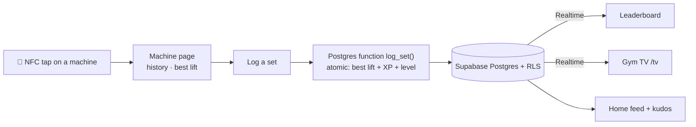

<div align="center">

# 🏋️ Racked by Bijlee

**Tap a machine. Log your set. Keep your streak.**<br>
An NFC-powered gym companion that turns every machine in the gym into a leaderboard.

[](https://racked-app-liard.vercel.app)


&nbsp;
&nbsp;


</div>

---

## Why I built it

Gym progress lives in people's heads, or in notes apps nobody opens twice. **Racked** puts a small NFC sticker on each machine. Tap it with your phone and you see your history and best lift for that machine, log the set in seconds, and watch where you rank against everyone else in the gym.

It is also an experiment for **[EZZ BILL](https://github.com/omkarpatilswork/ez-bill1)**. EZZ BILL's restaurant flow depends on people being willing to tap an NFC tag to get something, so Racked tests that habit cheaply, with real people, before EZZ BILL bets on it. Racked runs at [Bijlee](https://bijlee.run), my Pune community for runners, founders and builders.

## Features

| | |
|---|---|
| 📲 **Tap to log** | Each machine's NFC tag (or QR code) opens that machine: your history, your best lift and a quick set logger |
| 🏆 **Live leaderboards** | Overall and per-machine rankings for today, the week, the month or all time, updated in real time when anyone logs a set |
| 🔥 **XP, levels and streaks** | XP per set, levels per machine, attendance streaks and a calendar of the days you trained |
| 🆕 **Home feed** | An Instagram-style feed of sets and new best lifts, grouped by visit, with 🔥 kudos |
| 📸 **Progress photos** | Optional before and after photos, with kudos and reporting for moderation |
| 📺 **Gym TV mode** | `/tv` cycles through leaderboards full screen on the gym's TV, showing first names only |
| 📖 **Machine guides** | Form guides with animations for each machine, plus feedback on the machine itself |
| 🛠️ **Admin tools** | A staff-only dashboard for machines, tap analytics and photo moderation |
| 🔗 **Share cards** | Strava-style cards for a new best lift or leaderboard rank |

## How it works



**Design decisions**
- **Server-side truth.** Best lifts, XP and levels are written by a single atomic Postgres function, `log_set`. Two phones can't race each other, and no client can fake a best lift by writing to the database directly.
- **Realtime, not refresh.** The leaderboard subscribes to Postgres changes, so everyone watching sees a new set within a second or two.
- **Privacy by default.** Row Level Security is on every table. The TV screen shows first names and anonymous counts only, and Instagram handles are visible only to signed-in members.
- **Real accounts.** Google sign-in via Supabase Auth, and admin rights come from a flag on the account rather than a shared passcode.

## Built in public

Racked began as a Claude Artifact prototype. It became this deployable app in **Sept–Oct 2026**, and new features shipped as numbered database migrations:

`0001` core schema → `0002` leaderboards → `0003` admin tools → `0004` NFC vs QR tap tracking → `0005` gym TV → `0006` home feed and kudos → `0007` progress photos → `0008` Instagram handles

## Tech stack

Next.js 14 (App Router, TypeScript) · Supabase (Postgres, Auth with Google OAuth, Realtime, Storage, RLS) · Tailwind CSS · Vercel

## Run it yourself

The full setup takes about 20 minutes: Supabase project, Google sign-in, Vercel deploy and NFC stickers. It's in **[docs/SETUP.md](docs/SETUP.md)**.

```bash
git clone https://github.com/omkarpatilswork/racked-app.git
cd racked-app
npm install
cp .env.example .env.local   # add your Supabase URL and anon key
npm run dev
```

---

Built by **[Omkar Patil](https://github.com/omkarpatilswork)** for [Bijlee](https://bijlee.run) · Founder, [EZZ BILL](https://ezzbill.com)
